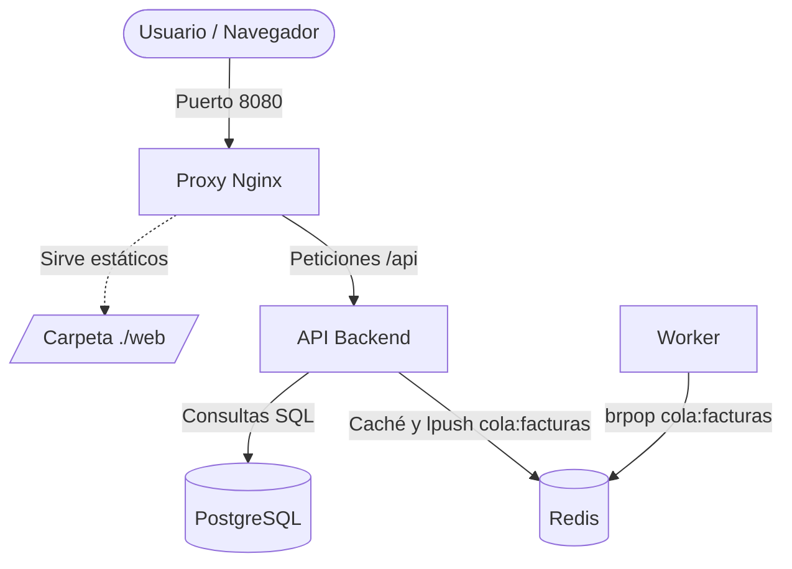
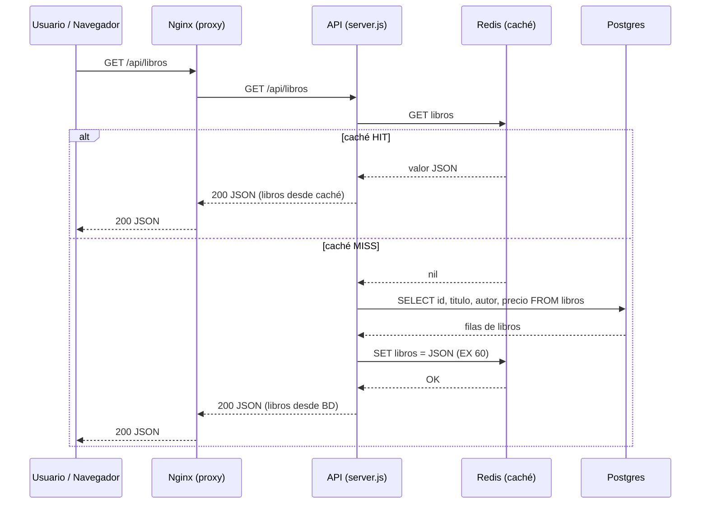
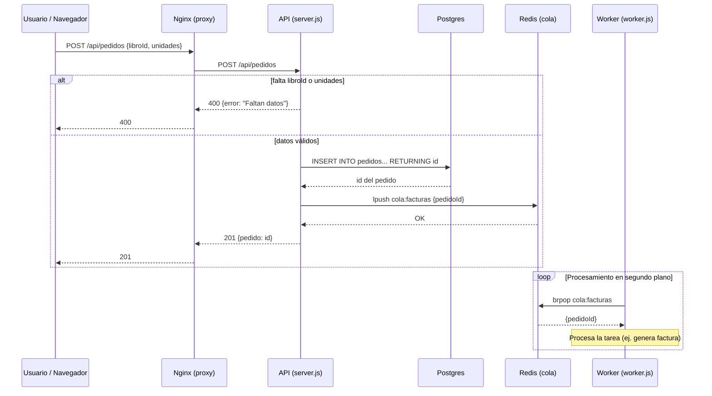

# Ejercicio 1: Diagrama de la arquitectura



**¿Por qué conviene un agente que no pueda escribir en fase de análisis?**

- **Seguridad:** evita que el agente modifique o rompa archivos accidentalmente mientras exploras el sistema.
- **Integridad:** garantiza que analizas el código y la arquitectura originales, sin alteraciones.
- **Enfoque:** obliga al agente a limitarse a leer y explicar, evitando cambios prematuros.

*(Nota: añade aquí tu captura de pantalla del rechazo en opencode.)*

---

# Ejercicio 2: Inventario de componentes

| Servicio | Imagen / Construcción | Puerto exterior | Puerto interno | Volúmenes | Dependencias | Función |
| :--- | :--- | :--- | :--- | :--- | :--- | :--- |
| **proxy** | `nginx:1.27-alpine` | 8080 | 80 | `./nginx/default.conf`<br>`./web` | `api` | Servidor web estático y proxy inverso que enruta el tráfico. |
| **api** | `build: ./api` | Ninguno | 3000 | Ninguno | `db`, `cache` | Backend principal de la aplicación (Node.js). |
| **worker** | `build: ./worker` | Ninguno | Ninguno | Ninguno | `cache` | Proceso en segundo plano que consume tareas. |
| **db** | `postgres:16-alpine` | Ninguno | 5432 (implícito) | `datos-db`<br>`./db/init.sql` | Ninguna | Base de datos relacional. |
| **cache** | `redis:7-alpine` | Ninguno | 6379 (implícito) | `datos-cache` | Ninguna | Caché y gestor de colas de tareas. |

**¿Cuántos servicios son accesibles desde fuera del equipo y por qué?**

Solo **uno**: el `proxy`. Es el único contenedor del `docker-compose.yml` que usa `ports: - "8080:80"`, que mapea el puerto 8080 del anfitrión al puerto 80 del contenedor. El resto de servicios solo se comunican a través de la red interna de Docker.

---

# Ejercicio 3: .gitignore

```gitignore
# Dependencias
node_modules/

# Secretos y entorno local
.env
.env.*
!.env.example

# Logs
*.log
npm-debug.log*

# Datos locales
*.rdb
*.sqlite

# Sistema / editor
.DS_Store
.vscode/
.idea/
```

---

# Ejercicio 4: Flujos de la aplicación

## 4.1 Flujo de lectura (GET /api/libros)



## 4.2 Flujo de escritura (POST /api/pedidos)



---

# Ejercicio 5: Modelo de arquitectura

**Modelo seguido y justificación:**

La aplicación sigue un modelo de **monolito con servicios de apoyo** (backend único con proxy, caché/cola y worker), orquestado con contenedores. No es una arquitectura de microservicios. Las evidencias son:

- **Despliegue conjunto:** todos los componentes se definen y se levantan a la vez desde un único `docker-compose.yml`, en un solo repositorio y con un único ciclo de vida.
- **Una sola base de datos, con un único propietario:** solo la `api` habla con PostgreSQL. El worker únicamente usa Redis.
- **Un único backend con la lógica de negocio:** la `api` concentra todas las operaciones (listar libros, crear pedidos). El worker solo ejecuta tareas diferidas que la API le encola.
- **Comunicación mixta:** síncrona entre Nginx y la API (proxy inverso), y asíncrona entre la API y el worker a través de la cola en Redis (`cola:facturas`).

**Contraste con la generalidad del agente:**

Es habitual que un agente clasifique el proyecto como "arquitectura de microservicios" solo porque hay varios contenedores Docker (web, api, worker, db, cache). Esa afirmación no se sostiene con las evidencias: tener varios contenedores no implica microservicios. En una arquitectura de microservicios real, cada servicio es dueño de sus datos (*database-per-service*), tiene su propio ciclo de despliegue y expone una responsabilidad de negocio independiente. Aquí solo hay un servicio de negocio (la API) y el resto son piezas de infraestructura.

**Ventajas e inconvenientes para una tienda pequeña:**

- **Ventajas:**
  - La API responde de inmediato (201) y el trabajo pesado (la factura) lo asume el worker en segundo plano, sin bloquear al usuario.
  - La caché en Redis reduce la carga sobre PostgreSQL en las lecturas.
  - Solo el proxy está expuesto al exterior, lo que reduce la superficie de ataque.
- **Inconvenientes:**
  - Es una infraestructura sobredimensionada (*overkill*): mantener y monitorizar 5 contenedores (Nginx, API, Worker, Redis y Postgres) añade complejidad operativa innecesaria.
  - Para el volumen de una tienda pequeña, un monolito tradicional con una base de datos simple sería más fácil de mantener.

---

# Ejercicio 6: Ficha de requerimientos de implantación

### 1. Hardware o Instancia
*   **Lo que la aplicación ya trae:** Nada (solo el requisito de funcionar sobre Docker).
*   **Lo que hay que añadir:** Un servidor VPS en la nube (ej. AWS EC2, DigitalOcean) con SO Linux (ej. Ubuntu 22.04), al menos 2 vCPU y 4GB de RAM para soportar los 5 contenedores.

### 2. Software y Versiones
*   **Lo que la aplicación ya trae:** Definición en `docker-compose.yml` con imágenes específicas (`nginx:1.27-alpine`, `postgres:16-alpine`, `redis:7-alpine`, y Node.js implícito en los builds).
*   **Lo que hay que añadir:** Instalación de Docker Engine y el plugin Docker Compose en el servidor de producción.

### 3. Red (Dominio, DNS, Puertos, Cortafuegos)
*   **Lo que la aplicación ya trae:** Mapeo del puerto 8080 del anfitrión al 80 del contenedor Nginx.
*   **Lo que hay que añadir:**
    *   Comprar un dominio y configurar el registro DNS (tipo A) apuntando a la IP del servidor.
    *   Cambiar el mapeo en el compose para usar los puertos estándar web (80 y 443).
    *   Configurar el cortafuegos (ej. UFW) para permitir *solo* el tráfico en los puertos 80, 443 y 22 (SSH), bloqueando el resto.

### 4. Seguridad y Secretos
*   **Lo que la aplicación ya trae:** Las credenciales de desarrollo definidas en `docker-compose.yml` (por ejemplo, la contraseña de Postgres escrita en claro; comprobar en el fichero), sin gestión de secretos para producción.
*   **Lo que hay que añadir:**
    *   Crear un archivo `.env` en el servidor con contraseñas seguras (`POSTGRES_PASSWORD` y, opcionalmente, una contraseña para Redis) y no subirlo a Git.
    *   Generar certificados SSL/TLS (ej. Let's Encrypt / Certbot) para cifrar el tráfico HTTPS en Nginx.

### 5. Entornos
*   **Lo que la aplicación ya trae:** Un único `docker-compose.yml` pensado para desarrollo.
*   **Lo que hay que añadir:** Un archivo `docker-compose.prod.yml` que incluya políticas de reinicio automático (`restart: always` o `unless-stopped`) y límites de recursos (CPU/memoria) para los contenedores.

### 6. Datos y Copias de Seguridad (Backups)
*   **Lo que la aplicación ya trae:** Volúmenes locales definidos (`datos-db`, `datos-cache`) para persistencia básica.
*   **Lo que hay que añadir:** Un script automatizado (ej. mediante `cron`) que ejecute un `pg_dump` diario de PostgreSQL y envíe el archivo `.sql` a un almacenamiento externo (ej. Amazon S3).

### 7. Monitorización y Registros (Logs)
*   **Lo que la aplicación ya trae:** Salida estándar de logs nativa de Docker.
*   **Lo que hay que añadir:** Un sistema centralizado de logs (ej. stack ELK o Grafana Loki) y monitorización de contenedores para lanzar alertas si la API o el Worker se caen.

### 8. Fases del despliegue y Plan de vuelta atrás (Rollback)
*   **Fases del despliegue:** 1) `git pull` de la nueva versión. 2) `docker compose build`. 3) `docker compose up -d` (recrea los contenedores modificados, con una breve interrupción).
*   **Plan de vuelta atrás:** 1) `git checkout <commit-anterior>`. 2) `docker compose build && docker compose up -d`. 3) Si la BD se corrompe, restaurar el último volcado con `psql < copia.sql`.

---

# Ejercicio 7: Caza de afirmaciones falsas

| Nº | Afirmación del agente (Frase exacta o resumida) | Fichero y línea que la desmienten | Afirmación correcta |
| :--- | :--- | :--- | :--- |
| **1** | *"El proyecto contiene una carpeta `tests/` para las pruebas unitarias."* | `ls -la` en la raíz del proyecto: no existe `tests/`. | No existe ninguna carpeta de pruebas, el agente alucinó este componente. |
| **2** | *"La aplicación sigue una arquitectura de microservicios."* | `docker-compose.yml` (servicios `api`, `worker`; solo `api` accede a `db`). | Es un monolito con servicios de apoyo: un único backend de negocio, una sola BD y un único despliegue. El resto son piezas de infraestructura. |
| **3** | *"La base de datos y la caché son accesibles externamente."* | `docker-compose.yml` (servicios `db` y `cache`, sin directiva `ports`; comprobar con `grep -n "ports" docker-compose.yml`). | No tienen directiva `ports` definida. Solo Nginx expone un puerto (8080) al exterior; el resto solo es accesible en la red interna de Docker. |
